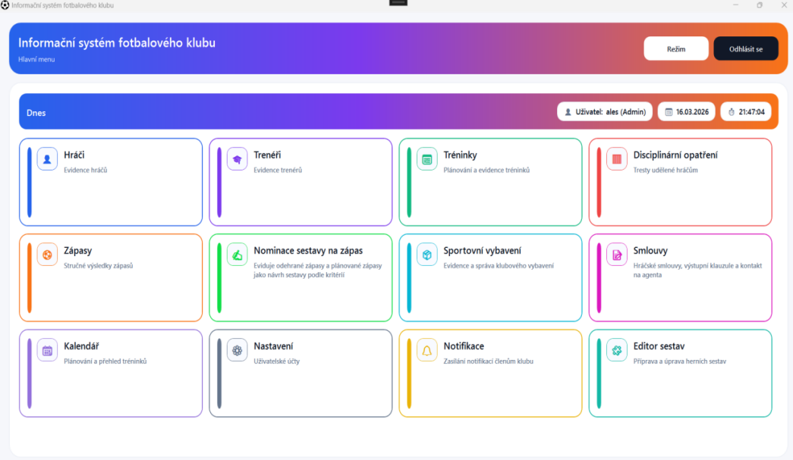
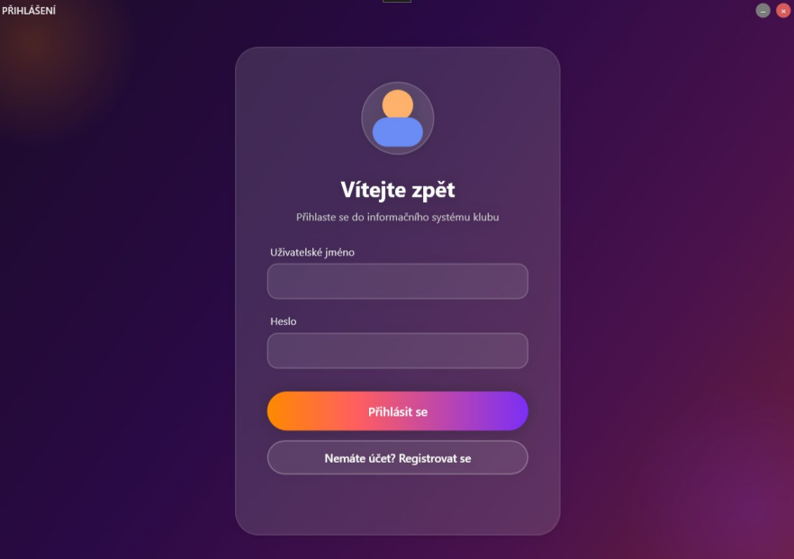
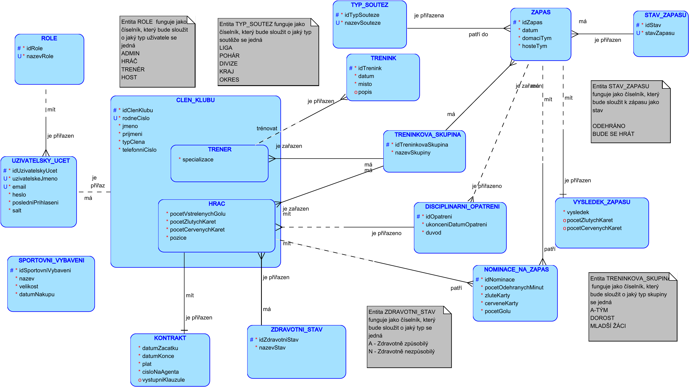
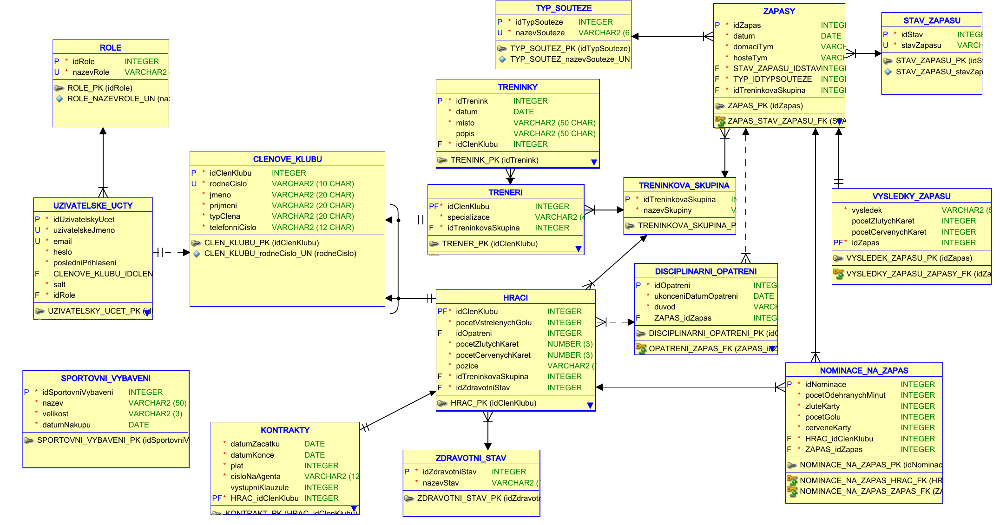

# ⚽ Systém pro správu sportovního fotbalového klubu

### Bakalářská práce | 2026

Desktopová aplikace pro správu fotbalového klubu vytvořená v jazyce **C#** s využitím **WPF**, **.NET 8** a databáze **Oracle**.

**Autor: Aleš Tlučhoř**  
Univerzita Pardubice · Fakulta elektrotechniky a informatiky  
Studijní obor: Informační technologie

  

  
  
  
  
  

---

## 📖 O projektu

Cílem bakalářské práce bylo navrhnout a implementovat informační systém pro správu sportovního fotbalového klubu. Aplikace soustřeďuje evidenci hráčů, trenérů, tréninkových skupin, tréninků a zápasů na jedno místo. Umožňuje také správu nominací, statistik, hráčských kontraktů, disciplinárních opatření a sportovního vybavení.

Součástí systému je řízení přístupu podle uživatelských rolí a grafický editor sestav, ve kterém lze připravovat rozestavení hráčů na fotbalovém hřišti.

V bakalářské práce se dále řešila analýza, návrh, funkční a nefunkční požadavky, implementace a uživatelské testování

🎓 **Bakalářská práce byla v roce 2026 úspěšně obhájena na Univerzitě Pardubice.**

## 🖥️ Ukázky aplikace

### Hlavní okno – světlý a tmavý režim

  
  

### Přihlašovací formulář

  

## ✨ Hlavní funkce

| Modul | Popis |
|---|---|
| ⚽ Hráči | Evidence hráčů, pozic, zdravotního stavu a statistik |
| 🧑‍🏫 Trenéři | Evidence trenérů a jejich specializací |
| 🏃 Tréninky a kalendář | Plánování a přehled tréninkových jednotek |
| 🏆 Zápasy | Evidence zápasů, výsledků a statistik |
| 👥 Nominace | Tvorba nominací hráčů na zápasy |
| 📋 Editor sestav | Grafické sestavování týmu přímo na hrací ploše |
| 🟥 Disciplinární opatření | Evidence trestů a jejich platnosti |
| 📝 Kontrakty | Evidence hráčských smluv a výstupních klauzulí |
| 🎽 Sportovní vybavení | Evidence klubového vybavení |
| ✉️ Notifikace | Odesílání e-mailových oznámení |
| ⚙️ Nastavení | Správa uživatelských účtů a oprávnění |

Další funkce zahrnují registraci, vyhledávání a filtrování záznamů, export vybraných dat do CSV a přepínání mezi světlým a tmavým režimem.

## 👥 Uživatelské role a testovací účty

Systém využívá řízení přístupu podle rolí (**RBAC – Role-Based Access Control**). Dostupné jsou role administrátor, trenér, hráč a host.

Pro vyzkoušení aplikace jsou připraveny následující testovací účty:

| Role | Uživatelské jméno | Heslo |
|---|---|---|
| Administrátor | `admin` | `pardubice` |
| Trenér | `trener` | `pardubice` |
| Hráč | `hrac` | `pardubice` |

Jednotlivé účty mají rozdílná oprávnění, takže je možné vyzkoušet aplikaci z pohledu různých uživatelských rolí.

## 🧩 Editor sestav

Grafický editor umožňuje vybírat hráče a umisťovat je přímo na fotbalové hřiště. Hráče lze přesouvat a připravovat různé varianty rozestavení. Při výběru lze zohlednit například tréninkovou skupinu, zdravotní stav, disciplinární opatření a individuální statistiky.

## 🛠️ Použité technologie a nástroje

| Technologie / nástroj | Využití |
|---|---|
| **C# a .NET 8** | Programovací jazyk a platforma aplikace |
| **WPF a XAML** | Desktopové uživatelské rozhraní |
| **Oracle Autonomous Database** | Cloudová databáze provozovaná v Oracle Cloud Infrastructure (OCI) |
| **Oracle.ManagedDataAccess.Core** | Připojení aplikace k databázi Oracle |
| **Oracle SQL Developer** | Práce s databází a SQL |
| **Oracle SQL Developer Data Modeler** | Návrh databáze a diagramů |
| **Microsoft Visual Studio 2022** | Vývojové prostředí |
| **Git a GitHub** | Správa zdrojového kódu |

Použité NuGet balíčky:

- `Oracle.ManagedDataAccess.Core` – verze `23.26.100`, komunikace s Oracle Database.
- `Extended.Wpf.Toolkit` – verze `5.0.0`, rozšířené ovládací prvky pro WPF.
- `FontAwesome.WPF` – verze `4.7.0.9`, ikony v uživatelském rozhraní.

## 🗄️ Databáze a databázové diagramy

Databázová část využívá **Oracle Autonomous Database** v prostředí **Oracle Cloud Infrastructure (OCI)**. Databáze neběží lokálně na počítači, aplikace se k ní připojuje vzdáleně.

Databázový návrh byl vytvořen v programu Oracle SQL Developer Data Modeler. Na základě návrhu byl připraven DDL skript pro vytvoření databázových tabulek, vazeb a omezení.

### ERD diagram

ERD diagram znázorňuje entity systému, jejich atributy a vzájemné vztahy. Zachycuje například vazby mezi členy klubu, hráči, trenéry, tréninky, zápasy a nominacemi.

  

[Otevřít původní ERD diagram ve formátu PDF](GitImages/Logical.pdf)

### Relační diagram

Relační diagram zobrazuje výslednou strukturu relační databáze – tabulky, jejich sloupce, datové typy, primární a cizí klíče a návaznosti mezi tabulkami.

  

[Otevřít původní relační diagram ve formátu PDF](GitImages/Relational_1.pdf)

## 🔐 Ukládání a ověřování hesel

Způsob práce s hesly je implementován ve třídě `PasswordHasher.cs`:

1. Pro každý účet se vygeneruje náhodný **salt** o velikosti 32 bajtů pomocí `RNGCryptoServiceProvider`.
2. Heslo a salt se spojí a z jejich UTF-8 reprezentace se vypočítá hash algoritmem **SHA-256**.
3. Hash i příslušný salt se ukládají do databáze.
4. Při přihlášení se hash ze zadaného hesla a uloženého saltu vypočítá znovu a porovná s uloženou hodnotou.

Výsledný hash a salt jsou v databázi uloženy jako text v kódování Base64. Implementace používá přímo SHA-256; nepoužívá PBKDF2, bcrypt ani Argon2.

## 📦 Bakalářská práce a další materiály

Tento GitHub repozitář slouží především ke sdílení **zdrojového kódu a ukázek aplikace**. Kompletní bakalářská práce a související odevzdané materiály jsou dostupné na portálu Theses.cz.

  

V rámci odevzdaných materiálů jsou k dispozici:

- 📘 Bakalářská práce ve formátu PDF.
- 📊 Prezentační soubor v PowerPointu.
- 💿 Instalační balíček aplikace – MSI a `setup.exe`.
- 🗄️ Databázový model vytvořený v Oracle SQL Developer Data Modeler.
- 📄 DDL skript pro vytvoření databázové struktury.
- 💻 Zdrojové soubory aplikace.

## 🚀 Spuštění projektu

1. Naklonujte GitHub repozitář.
2. Otevřete řešení `InformacniSystemKlub.sln` v Microsoft Visual Studio 2022.
3. Nainstalujte .NET 8 SDK a podporu WPF.
4. Obnovte potřebné NuGet balíčky.
5. Nastavte vlastní připojení k Oracle Database a údaje pro SMTP komunikaci.
6. Sestavte projekt a spusťte aplikaci.

Pro spuštění je potřeba funkční instance Oracle Database a odpovídající přístupové údaje.

---

## 👨‍🎓 Autor

**Aleš Tlučhoř**  
Univerzita Pardubice  
Fakulta elektrotechniky a informatiky (FEI)  
Studijní obor: Informační technologie  
Bakalářská práce – 2026

**Bakalářská práce byla úspěšně obhájena.**

---

  Děkuji za návštěvu projektu! ⚽

