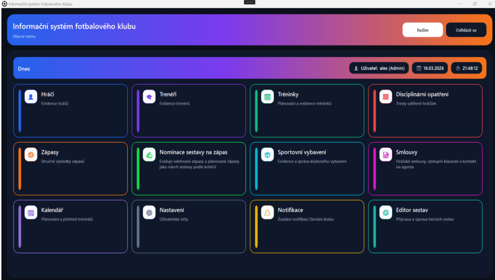
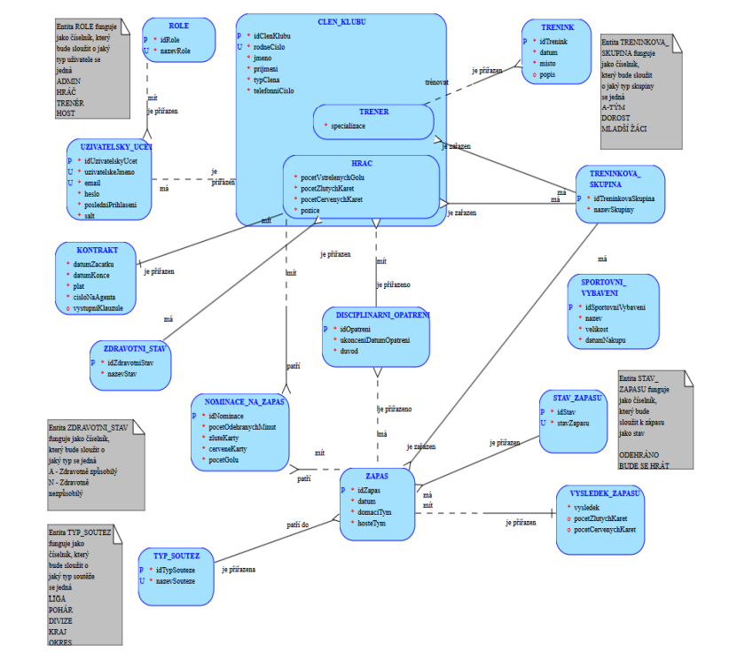
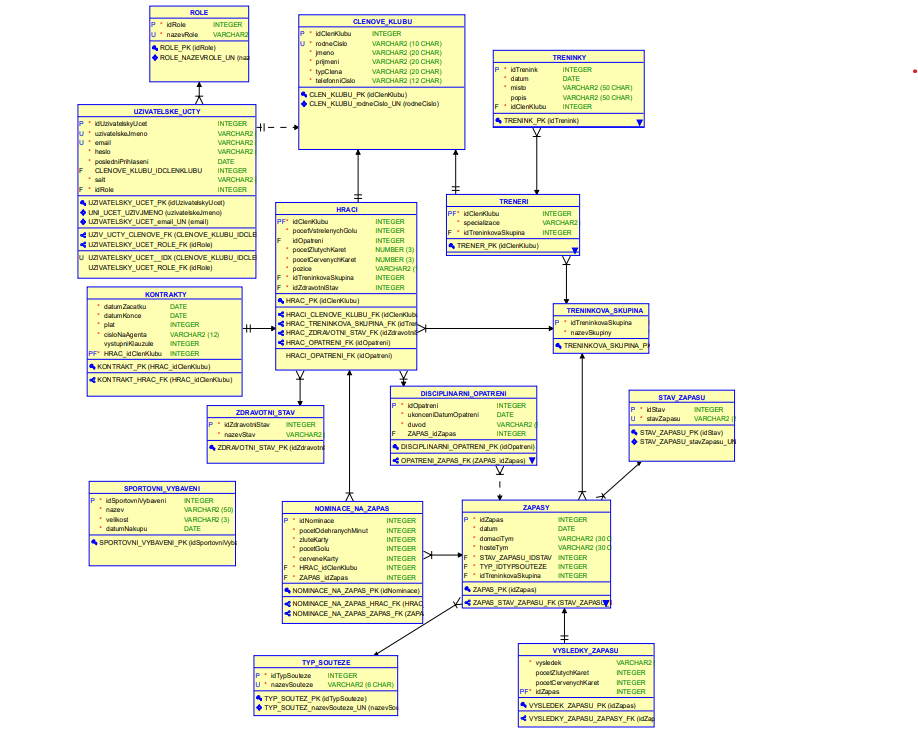

# ⚽ Systém pro správu sportovního fotbalového klubu

### Bakalářská práce | 2026

Desktopová aplikace pro komplexní správu fotbalového klubu vytvořená v jazyce C# s využitím WPF a databáze Oracle.

**Aleš Tlučhoř**

[Fakulta elektrotechniky a informatiky](https://fei.upce.cz/) · [Univerzita Pardubice](https://www.upce.cz/)

 

  

---

## 📖 O projektu

Cílem bakalářské práce bylo navrhnout a implementovat informační systém pro správu sportovního fotbalového klubu.

Aplikace soustřeďuje důležité informace o hráčích, trenérech, tréninkových skupinách, trénincích a zápasech na jedno místo. Umožňuje také evidenci hráčských kontraktů, disciplinárních opatření, statistik a sportovního vybavení.

Důležitou součástí systému je řízení přístupu podle uživatelských rolí a grafický editor sestav, který trenérům umožňuje navrhovat rozestavení hráčů na fotbalovém hřišti.

Výsledkem je funkční desktopová aplikace s moderním uživatelským rozhraním a cloudovou databází Oracle.

V bakalářské práci se dále řeší analýza, funkční a nefunkční požadavky, implementace a uživatelské testování.

🎓 **Bakalářská práce byla úspěšně obhájena v roce 2026 na Univerzitě Pardubice.**

## ✨ Hlavní funkce systému

| Modul | Popis |
|---|---|
| ⚽ Hráči | Evidence hráčů, statistik, pozic a zdravotního stavu |
| 🧑‍🏫 Trenéři | Evidence trenérů a jejich specializací |
| 🏃 Tréninky | Plánování a správa tréninkových jednotek |
| 📅 Kalendář | Přehled plánovaných tréninků |
| 🏆 Zápasy | Evidence zápasů, výsledků a statistik |
| 👥 Nominace | Sestavování nominací hráčů na zápasy |
| 📝 Kontrakty | Evidence hráčských smluv a výstupních klauzulí |
| 🟥 Disciplinární opatření | Evidence trestů a jejich platnosti |
| 🎽 Sportovní vybavení | Správa klubového vybavení |
| 📋 Editor sestav | Grafický návrh rozestavení hráčů na hřišti |
| ✉️ Notifikace | Odesílání e-mailových oznámení členům klubu |
| ⚙️ Nastavení | Správa uživatelských účtů a oprávnění |

Další funkce zahrnují registraci uživatelů, vyhledávání a filtrování záznamů, řazení tabulek, export vybraných dat do CSV a přepínání mezi světlým a tmavým režimem.

## 👥 Uživatelské role

Systém využívá princip **RBAC (Role-Based Access Control)**, tedy řízení přístupu na základě uživatelských rolí.

- **Administrátor** – plná správa systému, uživatelů a oprávnění.
- **Trenér** – správa tréninků, hráčů a příprava zápasů.
- **Hráč** – přístup k vybraným informacím a funkcím.
- **Host** – omezený přístup k systému.

Každá role má vlastní oprávnění, která určují dostupné části aplikace.

### 🔑 Testovací účty

Pro vyzkoušení aplikace jsou připraveny následující testovací účty:

| Role | Uživatelské jméno | Heslo |
|---|---|---|
| 🔴 Administrátor | `admin` | `pardubice` |
| 🟣 Trenér | `trener` | `pardubice` |
| 🔵 Hráč | `hrac` | `pardubice` |

**Poznámka:** Všechny testovací účty používají stejné heslo. Jednotlivé účty mají rozdílná oprávnění, takže je možné vyzkoušet aplikaci z pohledu různých uživatelských rolí.

## 🧩 Editor sestav

Jednou ze zajímavějších součástí projektu je grafický editor fotbalových sestav.

Umožňuje trenérovi vybírat hráče ze seznamu a umisťovat je přímo na hrací plochu. Hráče lze přesouvat a vytvářet různé varianty rozestavení.

Při výběru hráčů lze využít filtry podle tréninkové skupiny, zdravotního stavu, disciplinárních opatření nebo individuálních statistik.

## 🛠️ Použité technologie

| Technologie | Využití |
|---|---|
| **C#** | Programovací jazyk a aplikační logika |
| **.NET 8** | Vývojová platforma |
| **WPF** | Tvorba desktopového uživatelského rozhraní |
| **XAML** | Návrh grafických oken a ovládacích prvků |
| **Oracle Database** | Ukládání a správa dat |
| **Oracle Autonomous Database** | Provoz databáze v Oracle Cloud Infrastructure |
| **Oracle.ManagedDataAccess.Core** | Připojení aplikace k databázi Oracle |
| **Oracle SQL Developer** | Správa databáze a práce s SQL |
| **Oracle SQL Developer Data Modeler** | Návrh ERD a relačního modelu |
| **Microsoft Visual Studio 2022** | Vývojové prostředí |
| **Git a GitHub** | Správa verzí zdrojového kódu |

### Použité knihovny

- `Oracle.ManagedDataAccess.Core` – komunikace s databází Oracle.
- `Extended.Wpf.Toolkit` – rozšířené ovládací prvky pro WPF.
- `FontAwesome.WPF` – ikony v uživatelském rozhraní.

## 🗄️ Databáze a její návrh

Databázová část projektu využívá **Oracle Autonomous Database**, provozovanou v prostředí Oracle Cloud Infrastructure (OCI). Desktopová aplikace se k databázi připojuje vzdáleně.

Databázový model byl vytvořen v programu Oracle SQL Developer Data Modeler. Na základě návrhu byl vytvořen DDL skript, který sloužil k vytvoření databázových tabulek, vazeb a integritních omezení.

Databáze využívá primární a cizí klíče, unikátní omezení, kontrolní podmínky, sekvence .

## 🔐 Zabezpečení

Aplikace obsahuje přihlašování a registraci uživatelů. Hesla jsou ukládána v podobě hashů se solí, nikoliv v původní čitelné podobě.

Přístup k jednotlivým částem aplikace je omezen podle uživatelských rolí, což umožňuje oddělení oprávnění jednotlivých uživatelů.

---

## 🖥️ Ukázky aplikace

### Hlavní okno – světlý a tmavý režim

  
  

  <em>Uživatelské rozhraní hlavního menu v obou barevných režimech.</em>

### Přihlašovací formulář

  

  <em>Přihlašování uživatelů do informačního systému.</em>

## 📐 Databázový model

### ERD diagram

  

  <em>Konceptuální návrh databáze – entity a jejich vzájemné vztahy.</em>

### Relační model

  

  <em>Relační model databáze včetně tabulek, atributů a vazeb.</em>

---

## 📦 Zdrojové soubory a dokumentace

GitHub repozitář je určen především pro zdrojové soubory aplikace a ukázky jejího fungování.

Kompletní bakalářská práce a související materiály jsou dostupné na portálu **Theses.cz**.

Mezi doprovodné materiály projektu patří:

- 📘 Kompletní bakalářská práce ve formátu PDF.
- 📊 Prezentační soubor v PowerPointu k obhajobě.
- 💿 Instalační balíček aplikace.
- 🗄️ Databázový model vytvořený v Oracle SQL Developer Data Modeler.
- 📄 DDL skript pro vytvoření databázové struktury.

## 🚀 Spuštění projektu

Pro otevření a spuštění zdrojového kódu je potřeba:

1. Naklonovat tento GitHub repozitář.
2. Otevřít řešení `.sln` v Microsoft Visual Studio 2022.
3. Mít nainstalovaný .NET 8 SDK a podporu WPF.
4. Obnovit potřebné balíčky NuGet.
5. Nastavit vlastní připojení k databázi Oracle a údaje pro SMTP komunikaci.
6. Sestavit projekt a spustit aplikaci.

**Poznámka:** Pro připojení k databázi je potřeba funkční instance Oracle Database a odpovídající přístupové údaje.

---

## 👨‍🎓 Autor

### Aleš Tlučhoř

**Univerzita Pardubice**

Fakulta elektrotechniky a informatiky (FEI)

Studijní obor: Informační technologie

**Bakalářská práce – 2026**

<badge color="success">Úspěšně obhájena</badge>

---

**Děkuji za návštěvu projektu! ⚽**

